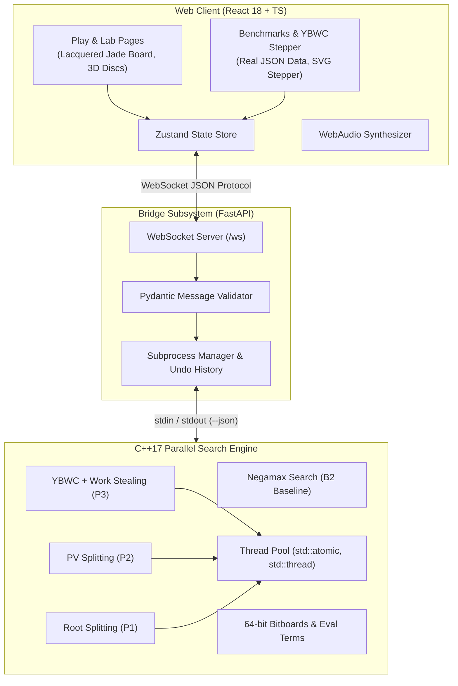

# Ebon & Ivory: Parallel Alpha-Beta Othello Engine

> **University Project**: Parallel Alpha-Beta Search for an Othello Engine: comparing Root Splitting, Principal Variation Splitting (PVS), and the Young Brothers Wait Concept (YBWC). Guided by Dr. Hingrajiya.

---

## 1. Architecture Overview



---

## 2. Algorithms Under Comparison

All engines share the exact same evaluation function (5 weighted terms: mobility, corners, positional weights, stability, disc difference), move generator, and move ordering to guarantee valid comparisons.

| Code | Algorithm | Parallel Strategy | Synchronization |
| :--- | :--- | :--- | :--- |
| **B2** | **Sequential Alpha-Beta** | Single-threaded reference | None |
| **P1** | **Root Splitting** | Partition legal moves at the root across $P$ threads | Join at root |
| **P2** | **Principal Variation Splitting (PVS)** | Search eldest child sequentially; search siblings in parallel with null-window scout | Sequential PV, parallel scout |
| **P3** | **Young Brothers Wait Concept (YBWC)** | Wait for eldest child; parallel search & work-stealing for young brothers | Threadpool with atomic steal / cancel |

---

## 3. Key Metrics & Exact Formulations

- **Speedup**: $S_P = \frac{T_1}{T_P}$
- **Efficiency**: $E_P = \frac{S_P}{P}$
- **Search Overhead**: $SO_P = \frac{N_P}{N_1} - 1$
- **Pruning Efficiency**: $\eta = 1 - \frac{N_{\alpha\beta}}{N_{\text{minimax}}}$
- **Effective Branching Factor**: $b^* = N_1^{1/d}$
- **Node Classification**:
  - **PV Node**: Exact value in $(\alpha, \beta)$ window; both bounds updated.
  - **CUT Node**: Move causes beta cutoff; at least one child refutes.
  - **ALL Node**: All children evaluated without cutoff; value $\le \alpha$.

---

## 4. Web Application Features

1. **Play Route (`/play`)**:
   - Lacquered dark jade board with coordinate labels and star points.
   - 3D physical disc flips with Chebyshev-distance stagger (60ms step).
   - Breathing brass legal move indicators.
   - Real-time engine telemetry sidebar: Thread lanes, NPS gauge, PV line, Eval breakdown.
   - Undo, Hint, and New Game configuration dialogs.

2. **Engine Lab (`/lab`)**:
   - Deep search inspection with per-thread activity states (`busy`, `idle`, `stealing`).
   - Diverging eval bar with exact sub-term contributions (§5.2).
   - "Compare vs Sequential (P=1)" one-click benchmark.

3. **Benchmarks (`/benchmarks`)**:
   - **RQ1 Search Overhead**: $SO_P$ vs $P$ per algorithm.
   - **Interactive YBWC Tree Stepper**: Visual step-through proving why waiting reduces visited leaves from 9 to 5 (+80% overhead in root splitting).
   - **RQ2 Scaling**: Speedup and efficiency tables with effective branching factor $b^*$.
   - **RQ3 Move Ordering**: Phase analysis across early, mid, and late game.
   - **Verification**: 100% value agreement check against sequential reference.
   - **Tournament**: Round-robin playing strength table with 95% confidence intervals.

4. **About (`/about`) & Styleguide (`/styleguide`)**:
   - Editorial writeup with KaTeX mathematical formulas.
   - Complete design token palette inspection.

---

## 5. Quickstart

### Automated Test Execution
```bash
# 1. C++ Tests (15 unit tests + equality tests)
./build/tests.exe
./build/test_equality.exe

# 2. Python Bridge & W9 E2E Tests
pytest server/tests/ -v

# 3. Web Frontend Build Check
cd web && npm run build
```

### Running Locally
```bash
# Terminal 1: FastAPI Bridge
python -m uvicorn server.app:app --host 127.0.0.1 --port 8000

# Terminal 2: Vite Dev Server
cd web
npm run dev
```

### Docker
```bash
docker compose up --build
```
Navigate to [http://localhost:8000](http://localhost:8000).

